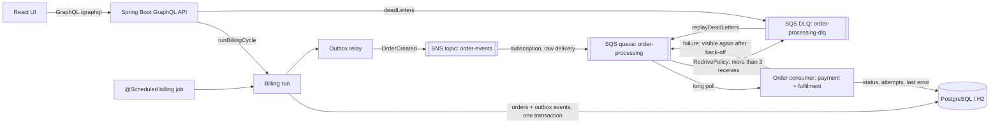
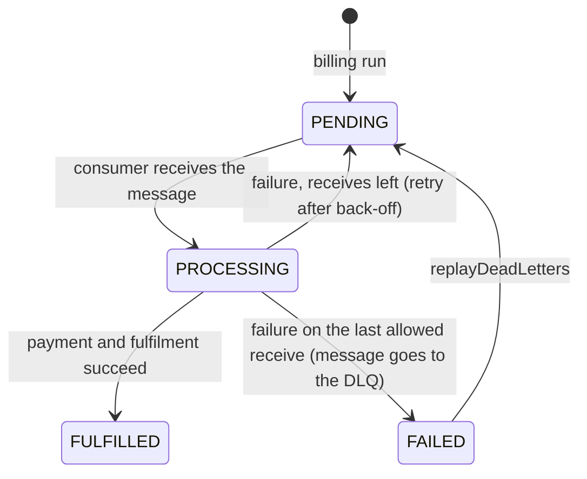

# Subscription Order Platform

Recurring orders with a React/TypeScript UI, a Spring Boot GraphQL API and an asynchronous **SNS → SQS**
processing pipeline with a **dead-letter queue** and replay. Docker images are built, smoke-tested and published
to GitHub Container Registry by GitHub Actions.

**Stack:** Java 17, Spring Boot 3.5, Spring for GraphQL, Spring Data JPA, Flyway, PostgreSQL/H2, AWS SDK v2
(SNS, SQS), React 19, TypeScript, Vite, TanStack Query, Docker, LocalStack, GitHub Actions.

## What it does

- **Subscriptions**: a customer subscribes to a plan with a quantity and a frequency (weekly, biweekly, monthly).
  Subscriptions can be paused, resumed (missed cycles are skipped, not back-billed) and cancelled.
- **Billing run**: a `@Scheduled` job (cron configurable) and the `runBillingCycle(asOf)` mutation create an
  order for every due cycle and advance `nextRunDate`. Run dates derive from an anchor date, so monthly schedules
  never drift (Jan 31 → Feb 28 → Mar 31). The run is **idempotent per subscription and run date**: a unique
  constraint on `(subscription_id, run_date)` plus optimistic locking make repeated or concurrent runs harmless.
- **Asynchronous pipeline**: each order's `OrderCreated` event is written to a transactional outbox in the same
  transaction as the order, then published to an **SNS topic**. An **SQS queue** subscribed to the topic delivers
  it to a long-polling consumer, which runs a simulated payment and fulfilment step and updates the order
  (`PENDING → PROCESSING → FULFILLED`). Successful messages are deleted. Failed ones become visible again after a
  linear back-off, and once a message has been received `maxReceiveCount` (3) times, the queue's
  **RedrivePolicy** moves it to the **DLQ**. The order is then `FAILED`.
- **DLQ operations**: `deadLetters` shows what is in the DLQ, and `replayDeadLetters` moves all or selected
  messages back to the queue with a fresh receive count. Each order is requeued before its message is re-sent.
- **Deterministic failure injection** (`NONE`, `TRANSIENT`, `PERMANENT`, optionally per plan) makes retries and
  dead-lettering reproducible, both in tests and in the UI.
- **Two broker implementations behind one interface**: AWS SDK v2 SNS/SQS (real AWS or LocalStack via an
  endpoint override) and an in-memory topic/queue/DLQ with the same semantics (visibility timeout, receipt
  handles, receive counts, redrive after 3 receives) for local development and tests.

## Architecture



Order lifecycle:



Notes on the design:

- **Outbox**: an order is never committed without its event, and no event is published for a rolled-back order.
  Delivery is at least once. The consumer is idempotent: a duplicate message for a fulfilled order is acknowledged
  and dropped.
- **Messaging interfaces** (`EventPublisher`, `MessageQueue`, `DeadLetterQueue`) are selected with
  `app.messaging.provider` (`in-memory` by default, `aws` in the `aws` profile).
- In AWS mode, the app only **looks up** the topic and queues. It never creates them. At startup it checks that
  the queue's RedrivePolicy targets the configured DLQ, and it takes `maxReceiveCount` from that policy.
  `localstack/init-aws.sh` creates the resources for LocalStack; Terraform or CDK would do the same in AWS.

## Project layout

```
backend/                 Spring Boot service (Maven wrapper, Dockerfile)
  src/main/java/com/subscriptionplatform/
    billing/             billing run + @Scheduled job
    subscription/ order/ catalog/ customer/   domain, services, repositories
    outbox/              transactional outbox + relay
    messaging/           broker interfaces; inmemory/ and aws/ (SNS/SQS SDK v2) implementations
    processing/          queue consumer, message handler, failure injection
    operations/          DLQ inspection, replay, queue stats
    graphql/             controllers, scalars, error mapping
    config/              clock, scheduling, fail-fast required-settings check
  src/main/resources/    application*.yml, graphql/schema.graphqls, db/migration (Flyway)
frontend/                React + TypeScript + Vite UI (Dockerfile, nginx template)
localstack/init-aws.sh   creates the SNS topic, SQS queue, DLQ, redrive policy and subscription
scripts/                 init-env.sh (creates .env), smoke-test.mjs (end-to-end GraphQL check)
docker-compose.yml       postgres + localstack + backend + frontend
.github/workflows/ci.yml build, test, Docker build, compose smoke test, GHCR publish
```

## Run locally (H2 + in-memory messaging)

Requirements: JDK 17+ and Node 22.12+. No database, Docker or AWS account needed.

```bash
cd backend && ./mvnw spring-boot:run        # API on http://localhost:8080/graphql, GraphiQL on /graphiql
cd frontend && npm install && npm run dev    # UI on http://localhost:5173 (proxies /graphql to :8080)
```

Demo data is seeded on startup: five plans, five customers, and seven subscriptions in different states. Today's
billing run has work to do. To see the whole pipeline: click **Run billing cycle**, watch the orders go to
*Fulfilled*, switch failure injection to **Permanent**, create a subscription and bill it again, and watch its
order fail three times and land in the dead-letter queue. Switch back to **None** and click **Replay**.

## Run the full stack with Docker (PostgreSQL + LocalStack)

```bash
scripts/init-env.sh            # once: creates .env from .env.example with a random POSTGRES_PASSWORD
docker compose up --build      # UI http://localhost:3000, API http://localhost:8080/graphql
node scripts/smoke-test.mjs    # optional end-to-end check through nginx (fulfilment, DLQ, replay)
docker compose down -v         # stop and remove the database volume
```

The backend runs with the `postgres,aws` profiles. Flyway creates the schema. The SNS/SQS clients point at
LocalStack, where `localstack/init-aws.sh` creates the topic, the queue (RedrivePolicy `maxReceiveCount=3`), the
DLQ, the queue policy and the subscription before the backend starts. LocalStack is pinned to `4.14.0`, the last
release that runs without an auth token; newer releases need `LOCALSTACK_AUTH_TOKEN`.

## GraphQL API

Schema: [`backend/src/main/resources/graphql/schema.graphqls`](backend/src/main/resources/graphql/schema.graphqls),
also served at `/graphql/schema`. Explore it interactively at `/graphiql`.

| Queries | Mutations |
|---|---|
| `plans`, `customers` | `createSubscription(input)` |
| `subscriptions(status)`, `subscription(id)` | `pauseSubscription(id)`, `resumeSubscription(id)`, `cancelSubscription(id)` |
| `orders(status, subscriptionId, limit)`, `order(id)` | `runBillingCycle(asOf)` |
| `deadLetters`, `queueStats`, `failureInjection` | `replayDeadLetters(messageIds)`, `setFailureInjection(mode, planCode)` |

```graphql
mutation {
  createSubscription(input: {
    newCustomer: { name: "Zoe Kim", email: "zoe@example.com" }
    planId: 1, quantity: 2, frequency: WEEKLY
  }) { id status nextRunDate recurringAmount }
}

mutation { runBillingCycle { asOf dueSubscriptions ordersCreated orders { id status amount } } }

query { orders(status: FAILED) { id attempts lastError subscription { customer { name } } } }

mutation { setFailureInjection(mode: PERMANENT, planCode: "MEAL-KIT") { mode planCode } }

query { deadLetters { messageId orderId sentAt order { status attempts } } queueStats { visible inFlight deadLetters } }

mutation { replayDeadLetters { replayed messageIds } }
```

With curl:

```bash
curl -s localhost:8080/graphql -H 'Content-Type: application/json' \
  -d '{"query":"mutation { runBillingCycle(asOf: \"2026-12-01\") { ordersCreated } }"}'
```

Domain errors come back as GraphQL errors with a classification: `BAD_REQUEST` (validation, invalid
transition) or `NOT_FOUND`. Money is a `Decimal` scalar serialized as a string, such as `"33.00"`. The SNS
event payload uses the same string form.

## Testing

```bash
cd backend && ./mvnw verify       # 96 unit tests (Surefire) + 27 integration tests (Failsafe)
cd frontend && npm run typecheck && npm run lint && npm run build
```

- **Unit tests**: billing scheduling and idempotency (catch-up, caps, duplicates, concurrent inserts), the cron
  job's time zone, subscription and order status transitions, subscription service rules, failure injection,
  message dispositions (ack/retry/dead-letter), the in-memory queue's SQS semantics (visibility timeout, receipt
  handles, DLQ after 3 receives, long polling, redrive), the SNS/SQS adapters against mocked SDK clients
  (requests, receive counts, selective redrive, RedrivePolicy validation), the event codec, and the fail-fast
  configuration check.
- **Integration tests** (full Spring context, H2, in-memory broker): the GraphQL API over HTTP with
  `HttpGraphQlTester`, the asynchronous pipeline end to end, a step-by-step retry → DLQ → replay walk-through
  with a controllable clock, concurrent billing runs, and the `@Scheduled` job.
- `scripts/smoke-test.mjs` runs the same scenario against a running stack. CI uses it to cover the PostgreSQL and
  LocalStack path.

## CI/CD

`.github/workflows/ci.yml` runs on pull requests and on pushes to `main`:

1. **backend**: `./mvnw verify` on JDK 17. Test reports are uploaded on failure.
2. **frontend**: `npm ci`, `typecheck`, `lint` and `build` on Node 24.
3. **docker** (after both): builds both images with Buildx (GitHub Actions layer cache), generates a throwaway
   `.env`, starts the compose stack (PostgreSQL, LocalStack, backend, frontend), and runs the smoke test through
   nginx. On pushes to `main` it then pushes the tested images to GitHub Container Registry:
   - `ghcr.io/<owner>/subscription-order-platform-backend:{latest, sha-<commit>}`
   - `ghcr.io/<owner>/subscription-order-platform-frontend:{latest, sha-<commit>}`

Publishing authenticates with the workflow's built-in `GITHUB_TOKEN` (`packages: write` on that job only).
**No repository secrets are needed.** If a deployment step ever needs one, add it under *Settings → Secrets and
variables → Actions*, reference it as `${{ secrets.NAME }}`, and list it here.

## Configuration & secrets

Every environment-specific setting is read from an environment variable through a `${VAR:default}` placeholder
in [`application.yml`](backend/src/main/resources/application.yml). The defaults are non-secret values for local
development: in-memory H2 and the in-memory broker. The `postgres` profile has **no defaults at all**. With the
`postgres` or `aws` profile active, the application refuses to start and lists every missing variable before it
creates any bean.

| Variable | Required | Secret | Default | Purpose |
|---|---|---|---|---|
| `SPRING_PROFILES_ACTIVE` | no | no | none (H2 + in-memory) | `postgres`, `aws`, or `postgres,aws` (compose) |
| `SERVER_PORT` | no | no | `8080` | HTTP port of the backend |
| `SPRING_DATASOURCE_URL` | with `postgres` | no | H2 in-memory | JDBC URL |
| `SPRING_DATASOURCE_USERNAME` | with `postgres` | no | `sa` (H2 only) | Database user |
| `SPRING_DATASOURCE_PASSWORD` | with `postgres` | **yes** | none (H2: empty) | Database password |
| `POSTGRES_DB`, `POSTGRES_USER` | compose | no | `subscriptions` | Database and user of the postgres container (also used to build the JDBC URL) |
| `POSTGRES_PASSWORD` | compose | **yes** | none | Password of the postgres container, passed to the backend as `SPRING_DATASOURCE_PASSWORD`; generated by `scripts/init-env.sh` |
| `MESSAGING_PROVIDER` | no | no | `in-memory` (`aws` profile: `aws`) | Broker implementation |
| `AWS_REGION` | with `aws` | no | none | Region of the SNS topic and SQS queues |
| `AWS_ENDPOINT_URL` | no | no | none | Endpoint override, e.g. LocalStack `http://localstack:4566` |
| `SNS_ORDER_TOPIC_ARN` or `SNS_ORDER_TOPIC_NAME` | one, with `aws` | no | none (`.env.example`: `order-events`) | Topic for `OrderCreated` events |
| `SQS_ORDER_QUEUE_URL` or `SQS_ORDER_QUEUE_NAME` | one, with `aws` | no | none (`order-processing`) | Queue subscribed to the topic |
| `SQS_ORDER_DLQ_URL` or `SQS_ORDER_DLQ_NAME` | one, with `aws` | no | none (`order-processing-dlq`) | Dead-letter queue (must be the queue's redrive target) |
| `AWS_ACCESS_KEY_ID`, `AWS_SECRET_ACCESS_KEY` | no | **yes** (real AWS) | none | Read only by the AWS SDK default credentials chain, never by app config. Compose sets LocalStack's dummy `test`/`test`; in AWS use an IAM role instead |
| `MESSAGING_MAX_RECEIVE_COUNT` | no | no | `3` | Receives before dead-lettering (in-memory broker; also used by `init-aws.sh` for the RedrivePolicy) |
| `MESSAGING_RETRY_BACKOFF` | no | no | `2s` | Base retry delay, multiplied by the receive count |
| `MESSAGING_VISIBILITY_TIMEOUT` | no | no | `30s` | Visibility timeout of the in-memory queue |
| `MESSAGING_CONSUMER_ENABLED` | no | no | `true` | Run the queue consumer in this instance |
| `MESSAGING_CONSUMER_WAIT_TIME` | no | no | `5s` (`aws`: `10s`) | Long-poll wait per receive |
| `BILLING_SCHEDULER_ENABLED` | no | no | `true` | Run the cron billing job in this instance |
| `BILLING_CRON` | no | no | `0 0 6 * * *` | Spring cron for the billing job |
| `BILLING_ZONE` | no | no | `UTC` | Time zone of the cron and of "today" |
| `BILLING_MAX_CATCH_UP_CYCLES` | no | no | `12` | Most cycles billed per subscription in one run |
| `OUTBOX_RELAY_INTERVAL` | no | no | `5s` | Sweep interval for unpublished outbox events |
| `FAILURE_INJECTION_MODE` | no | no | `NONE` | `NONE`, `TRANSIENT` or `PERMANENT` at startup |
| `FAILURE_INJECTION_PLAN_CODE` | no | no | empty (all plans) | Limit injected failures to one plan |
| `PROCESSING_SIMULATED_LATENCY` | no | no | `400ms` | Duration of the simulated payment step |
| `CORS_ALLOWED_ORIGINS` | no | no | `http://localhost:5173` | Origins allowed to call the API cross-origin (comma-separated) |
| `GRAPHIQL_ENABLED` | no | no | `true` | Serve GraphiQL at `/graphiql` |
| `SEED_DEMO_DATA` | no | no | `true` | Seed demo data into an empty database |
| `LOG_LEVEL` | no | no | `INFO` | Log level of the application's packages |
| `FRONTEND_PORT`, `BACKEND_PORT`, `LOCALSTACK_PORT` | no | no | `3000`, `8080`, `4566` | Ports compose publishes on 127.0.0.1 |
| `BACKEND_IMAGE`, `FRONTEND_IMAGE` | no | no | `subscription-order-platform-*:local` | Image names compose uses (CI sets the tested tags) |
| `BACKEND_URL` | no | no | `http://backend:8080` | Where the frontend's nginx forwards `/graphql` |
| `VITE_GRAPHQL_URL` | no | no | `/graphql` | GraphQL endpoint compiled into the UI (build time) |
| `VITE_DEV_PROXY_TARGET` | no | no | `http://localhost:8080` | Backend for the Vite dev-server proxy |
| `VITE_POLL_INTERVAL_MS` | no | no | `2000` | Refresh interval of the live UI panels |
| `SQS_VISIBILITY_TIMEOUT_SECONDS` | no | no | `30` | Visibility timeout `init-aws.sh` sets on the LocalStack queue |

**How secrets are handled**

- There are two real secrets: the **database password**, and **AWS credentials** when running against real AWS.
  Neither appears in code, `application*.yml`, Dockerfiles, `docker-compose.yml` or CI YAML. The only literal
  credentials in the repo are LocalStack's documented dummy values `test`/`test` in `docker-compose.yml`. They
  are marked as such and only work against LocalStack.
- **Locally with compose**: `scripts/init-env.sh` copies [`.env.example`](.env.example) to `.env` and fills
  `POSTGRES_PASSWORD` with `openssl rand -hex 24`. It never overwrites an existing `.env` and creates it readable
  only by you. Compose reads the password from `.env` through `${POSTGRES_PASSWORD:?...}` and stops with an error
  if it is missing. `.env` and `.env.*` are gitignored; only the `.env.example` files are tracked.
- **Running the jar or the image directly**: export the variables in your shell or pass them with
  `docker run -e`/`--env-file`.
- **In production**: inject the variables from the platform's secret store, never from a file in the image.
  Examples: ECS task definition `secrets` from AWS Secrets Manager or SSM Parameter Store, or a Kubernetes
  `Secret` mapped with `envFrom`. Give the service an IAM role (ECS task role, EKS IRSA) for SNS/SQS access, so
  no AWS keys exist at all. The SDK's default provider chain picks the role up.
- **Frontend**: only `VITE_*` variables reach the browser bundle. They are public by design, so never put
  anything secret in them. See [`frontend/.env.example`](frontend/.env.example).
- **CI** needs no secrets. Tests run on H2 with the in-memory broker. The smoke-test stack gets a freshly generated
  `.env`, and GHCR publishing uses the built-in `GITHUB_TOKEN`.
